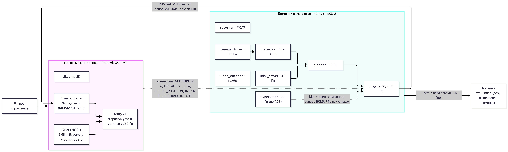

# Архитектура бортового ПО БВС

Pixhawk 6X (PX4) · бортовой вычислитель Intel NUC (Linux) · наземная станция SIYI UniRC 7. Датчики: камера, лидар, ГНСС. Задача: автономный облёт объекта с распознаванием цели.

## 1. Схема модулей

| Процесс | Узел | Частота | Задержка / целевой бюджет | Интерфейс |
| -- | -- | -- | -- | -- |
| Контуры угловой скорости и угла, моторы | ПК (Pixhawk 6X) | ≥250 Гц | цикл ≤4 мс | внутренний PX4 |
| EKF2, контур скорости/положения | ПК | EKF2: 100–250 Гц; контур положения: ≥50 Гц | ≤10 мс | внутренний PX4 |
| Commander, Navigator, failsafe (батарея, геозона, потеря линий, RTL) | ПК | по внутренним циклам PX4 | зависит от настроек failsafe | внутренний PX4 |
| `fc_gateway` (MAVLink ↔ ROS 2) | БВ (Intel NUC)| 20 Гц для команд | целевой бюджет обработки ≤5 мс на узел | MAVLink 2 / UDP|
| `camera_driver`, `lidar_driver`| БВ| камера: 30 FPS; лидар: 10 Гц| кадр → память ≤15 мс, целевой показатель| ROS 2|
| `detector` (нейросеть, CV)| БВ| 15–30 Гц| ≤60 мс на кадр, целевой показатель| ROS 2|
| `planner` (облёт, обход препятствий по лидару) | БВ| 10 Гц| ≤20 мс на цикл, целевой показатель| ROS 2|
| `supervisor` (watchdog, мониторы, решения об отказах) | БВ| 20 Гц| обнаружение отказа ≤200 мс для соответствующих программных проверок | отдельный процесс, не зависит от DDS |
| `video_encoder`| БВ| 30 FPS| ≤50 мс, целевой бюджет| RTP/IP вниз |
| `recorder` | БВ| по потокам | не блокирует контур управления| отдельная очередь и дисковая квота|

**Почему граница именно здесь.**

На ПК остаётся всё, что критично для стабилизации и безопасности:

1. Контуры управления, оценивание состояния и управление моторами.
2. Штатные failsafe PX4: батарея, геозона, потеря RC и наземного канала, потеря Offboard, переход в безопасный режим.
3. Функции, которые должны сохранять работоспособность при отказе NUC.

На БВ — вычислительно тяжёлое восприятие, распознавание цели, планирование и запись данных.

БВ — недоверенный источник команд: он выдаёт ограниченные задания скорости или положения, которые PX4 принимает только при выполнении условий режима управления и собственных ограничений. PX4 вправе отклонить команду или перейти в настроенный failsafe.

## 2. Стык борт — полётный контроллер

Протокол: MAVLink 2.

Транспорт: UDP для Ethernet; для UART — MAVLink 2 поверх последовательного канала.

**Выбор:**

- MAVLink 2 — стандартный протокол взаимодействия PX4 с внешними системами, включая Offboard и наземные станции.
- UDP не требует установления соединения и повторной передачи потерянных пакетов на транспортном уровне. Это позволяет избегать задержек из-за повторной передачи устаревших данных, но требует самостоятельно контролировать потери, свежесть команд и состояние канала.
- MAVLink содержит контроль целостности пакетов и последовательный номер `seq`. Они помогают выявлять повреждения и пропуски, но сами по себе не обеспечивают подтверждение исполнения команды, защиту от повторов или проверку её актуальности.

**Физическая линия и резервирование.**

Основная — Ethernet 100 Мбит/с NUC ↔ Pixhawk 6X напрямую, кабель около 0,3 м, целевой RTT менее 1 мс.

Резервная — UART 921 600 бод. При 8N1 теоретическая пропускная способность составляет около 92 кбайт/с без учёта дополнительных ограничений реализации.

Резерв — активный: `fc_gateway` передаёт команды и `HEARTBEAT` по обоим каналам одновременно, `supervisor` мониторит их состояние раздельно. Чтобы исключить двойное исполнение, задержанные команды и переключение на устаревшие данные, необходимы общая нумерация команд, идентификация сессии, проверка свежести и правила выбора актуальной команды на принимающей стороне.

Переход на резервный канал выполняется по результатам проверки доставки и свежести команд. Повтор команды через 100 мс допустим только для команд, повторное исполнение которых безопасно. После двух неудачных попыток можно переключиться на резервный канал.

Резервирование каналов защищает от отказа отдельного интерфейса, кабеля или драйвера, но не защищает от отказа питания NUC или Pixhawk.

**Нагрузка.**

Оценка трафика ПК → БВ по Ethernet:

- ATTITUDE, 50 Гц — около 2,0 кБ/с;
- ODOMETRY, 30 Гц — около 7,4 кБ/с;
- GLOBAL_POSITION, 10 Гц — около 0,4 кБ/с;
- GPS_RAW_INT, 5 Гц — около 0,3 кБ/с;
- HIGHRES_IMU, 50 Гц — около 3,7 кБ/с;

Итого ориентировочно 15 кБ/с, или 0,12 Мбит/с. Это около 0,12% от 100 Мбит/с.

На резервной UART передаётся сокращённый набор сообщений: HEARTBEAT, ATTITUDE, GLOBAL_POSITION_INT, BATTERY_STATUS, STATUSTEXT. Оценка 2,6 кБ/с соответствует примерно 2,8% от теоретических 92,16 кБ/с.

БВ → ПК: команды 20 Гц × около 65 байт на пакет дают ориентировочно 1,3 кБ/с, без дополнительных служебных сообщений.

## 3. Стык борт — наземная станция

| Что| Направление | Формат| Скорость |
| -- | -- | -- | -- |
| Видео| вниз| H.265 1080p30, RTP/RTSP | 8 Мбит/с|
| MAVLink-телеметрия, прореженная для НС| вниз| MAVLink 2/UDP| 0,9 кБ/с полезного трафика ≈ 20 кбит/с общего трафика|
| Прикладная телеметрия 5 Гц, здоровье модулей 1 Гц | вниз| UDP| ~ 20 кбит/с|
| Команды оператора, HEARTBEAT НС 1 Гц, загрузка задания (разово ≤200 кБ) | вверх | MAVLink 2| >5 кбит/с в среднем|

Итого вниз ≈8,05 Мбит/с, или около 12,4% от номинальных 65 Мбит/с. Остаток относительно номинала — около 57 Мбит/с.

**Деградация до 10%.**

Управляющий и телеметрический трафик имеет приоритет над видео. При уменьшении доступной пропускной способности видеобитрейт снижается по оценке канала; если канал становится недостаточным, допускается дополнительное снижение частоты кадров или разрешения.

Контур управления «БВ → ПК» остаётся бортовым и не должен зависеть от доступности радиолинии до НС.

**Полная потеря связи.**

Таймеры HEARTBEAT НС:

- 3 с без актуального HEARTBEAT — `LINK_LOST`: запрет операторо-зависимых шагов и запись события в бортовой журнал.
- 5 с — `supervisor` запрашивает RTL, если состояние навигации, высота и условия полёта допускают этот режим.
- 10 с — независимый failsafe PX4 по потере наземного канала.

RTL не гарантирует безопасного возвращения при недостоверной навигации или недоступной домашней точке. Если RTL недоступен, действует настроенная реакция PX4 на соответствующее состояние.

Восстановление связи не отменяет RTL автоматически. Возврат к автономному заданию разрешается только после проверки состояния системы и явного подтверждения оператора.

## 4. Синхронизация времени

Принцип: во всей обработке используются метки времени измерения, а не время прихода сообщения. Для абсолютных меток применяется согласованная временная шкала, привязанная к ГНСС. Для таймеров, измерения интервалов и watchdog используется монотонная шкала времени, не подверженная скачкам системных часов.

| Источник| Как получаем метку| Погрешность|
| -- | -- | -- |
| Лидар| Аппаратная метка измерения, синхронизация через PPS/PTP, если поддерживается устройством| Цель ≤1 мс при подтверждённой аппаратной синхронизации|
| Камера | Аппаратный триггер; метка сопоставляется с фактическим моментом экспонирования с учётом задержки камеры| Цель 1–2 мс при калиброванной задержке и подтверждённой синхронизации|
| ПК (Pixhawk) | `time_boot_ms` с разрешением 1 мс; оценка смещения временных шкал через MAVLink `TIMESYNC` с фильтрацией дрейфа и задержек | Определяется измерениями RTT, асимметрией задержек, дрейфом и квантованием; ±0,5 мс не гарантируется |

`TIMESYNC` позволяет оценивать смещение часов, но не гарантирует заданную точность при асимметричной задержке, джиттере или нестабильном канале. После перезапуска Pixhawk, сброса `time_boot_ms` или скачка системного времени оценка синхронизации сбрасывается и восстанавливается заново.

Сопоставление: кольцевой буфер состояния ПК за 2 с (ATTITUDE 50 Гц, ODOMETRY 30 Гц); поза на момент кадра вычисляется интерполяцией. Экстраполяция запрещена дальше 100 мс. При превышении порога данные помечаются как устаревшие.

Цена рассинхронизации 100 мс при 10 м/с: 0,1 с × 10 м/с = 1,0 м вдоль трека. При угловой скорости 30°/с за это время возникает угловая ошибка 3°. На дальности до цели 50 м поперечная ошибка составляет 50 tan 3° ≈ 2,62 м. При ортогональных составляющих суммарная ошибка составляет около 2,8 м.

## 5. Выбор ROS

ROS 2 Jazzy, Ubuntu 24.04 — для слоя восприятия и планирования; не для критичных контуров безопасности.

Отказ от ROS 2 потребовал бы самостоятельно реализовать или интегрировать драйверы камеры и лидара, TF-дерево, запись и воспроизведение данных (`rosbag2`), инструменты визуализации и диагностики.

`fc_gateway` и `supervisor` — отдельные процессы с минимальными зависимостями, не зависящие от работоспособности DDS. При отказе ROS они должны сохранять возможность обнаружить потерю актуальных данных и прекратить выдачу команд автономного планирования.

Цена выбора:

1. DDS не гарантирует жёстких временных ограничений, для критичных контуров управления он не используется.
2. Копирование изображений создаёт значительную нагрузку. Для снижения накладных расходов применяются composable nodes, intra-process communication и поддерживаемые драйверами механизмы передачи изображений без лишнего копирования.
3. Требуется конфигурация DDS, например CycloneDDS, с явным выбором сетевых интерфейсов и проверкой обнаружения узлов.
4. Стек привязан к совместимой версии ОС, ROS 2 и драйверов.
5. ROS 2 и DDS создают дополнительные накладные расходы CPU и RAM, зависящие от конфигурации и нагрузки системы.

## 6. Деградация и отказы

| Событие | Как детектируется | Реакция | Кто решает |
| -- | -- | -- | -- |
| Зависание БВ | ПК: отсутствие свежих команд более 0,5 с. Аппаратный watchdog БВ инициирует перезагрузку| PX4 выполняет настроенную реакцию на потерю Offboard | ПК |
| Потеря камеры | Нет свежих кадров более 200 мс | `planner` прекращает сближение с целью. Более 2 с — HOLD или иной настроенный безопасный режим и уведомление оператора; более 30 с — запрос RTL при допустимых условиях | `supervisor` → ПК |
| Потеря лидара | Нет свежих сканов более 300 мс | Прерывание облёта. Дальнейшее движение допускается только при наличии достаточных альтернативных данных для обнаружения препятствий; иначе — переход в безопасный режим и запрос RTL или посадки | `supervisor` → ПК |
| Потеря/деградация ГНСС | ПК: диагностика EKF и штатный GNSS/EKF failsafe; БВ: `GPS_RAW_INT` | ПК выбирает допустимый режим исходя из доступности оценки положения, высоты и других датчиков. Без независимой проверки целостности навигации обнаружение подмены ГНСС не гарантируется | ПК |
| Перезагрузка БВ в полёте | ПК: отсутствие свежих команд; NUC: после старта фиксируются сброс сессии, изменение идентификаторов/счётчиков| PX4 выполняет настроенный failsafe. После старта БВ не возобновляет задание автоматически: восстанавливает журнал, публикует `RECOVERED` и ждёт подтверждения оператора| ПК, затем оператор |
| Переполнение диска логами | `recorder`: мониторинг свободного места и дисковой квоты| Отдельный раздел логов, ротация и ограниченная очередь. При переполнении очереди кадры отбрасываются со счётчиком. Запись не должна блокировать контур управления; критичные события сохраняются с приоритетом| `recorder`|
| Перезагрузка/сброс ПК | БВ: изменение `time_boot_ms`, сброс счётчиков/состояния сессии, потеря HEARTBEAT или переход PX4 в состояние неготовности| Остановка командного потока, сброс буфера поз и оценки TIMESYNC, уведомление оператора. После восстановления соединения команды не возобновляются до проверки состояния и повторного разрешения| `supervisor`|

**Кто имеет полномочия прекратить задание (по приоритету безопасности):**

1. Пилот с РУ — ручной перехват управления.
2. ПК (Pixhawk) — собственные failsafe по батарее, геозоне, навигации, RC, Offboard и наземному каналу. Они не должны зависеть от работоспособности БВ.
3. Оператор с НС — команды HOLD/RTL/LAND по MAVLink, если связь доступна и команда разрешена текущим состоянием.
4. `supervisor` на БВ — может запросить HOLD/RTL/LAND и остановить поток команд. `supervisor` не может отменить штатный failsafe PX4 или безопасно дизармить аппарат в воздухе по своему усмотрению.
5. `planner` — не имеет права самостоятельно менять режим полёта, отменять failsafe или разрешать продолжение задания после критического отказа. Он передаёт результаты планирования и признаки деградации в `supervisor`.
